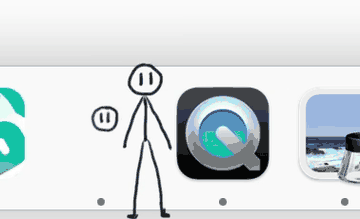
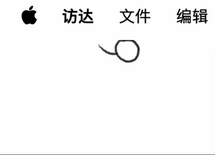
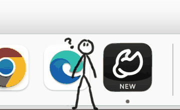
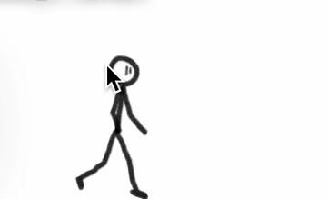
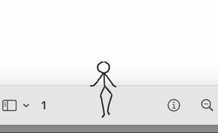
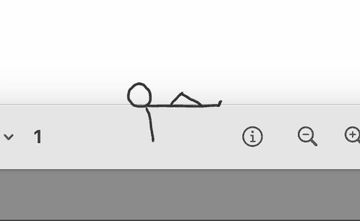
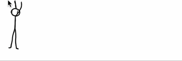
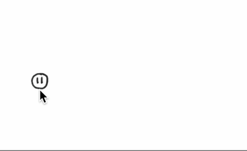

# MONO


> MONO — a monochrome stickman desktop pet that keeps you company. Not affiliated with the Mono/.NET project.

**English** · [简体中文](README.zh-CN.md)

**[Download for macOS](https://github.com/Hot-Peter/mono-desktop-pet/releases/latest)** — unzip, drag `MONO.app` into Applications, done.

**MONO** (short for *monochrome*: drawn in plain black ink) is a tiny hand-drawn
stickman that lives on your macOS desktop. Most of the time it hangs from the top edge of your
screen as a little ball; double-click it and it drops down to take a walk, climb your walls and
ceiling, or doze off on top of a window — occasionally popping up a speech bubble to report your
network speed, battery level, or how warm your machine is running.

All artwork (97 hand-drawn animation frames + speech-bubble sprites + icon) is bundled inside the
repository, so the app builds and runs fully offline — no external resources, no network requests,
no data collection.

## Demo



### All the little things it does

| Idle | Wave | Ponder |
|:---:|:---:|:---:|
|  |  |  |
| **Blush** | **Sit on a window** | **Lie down** |
|  |  |  |
| **Wall crawl** | **Ceiling climb** | **Drag & drop** |
|  |  |  |

## Features

- **Idle**: a ball tied to the top-left of the screen, spinning its rope
- **Double-click the ball**: it drops onto the desktop and starts walking
- **Single-click the ball**: opens the menu (language, always-on-top when sitting, AI-agent
  launcher, back to idle, quit…)
- **Drag it**:
  - release near the top edge → it hangs upside down and crawls along the top of the screen
  - release near the left/right edge → it climbs the wall
  - release near a window's title bar → it sits on the window and dozes off (lies down if you
    wait long enough)
  - close the window it sits on → it turns back into a ball, drops down and walks off
  - release anywhere else → it lands and keeps strolling
- **While walking**: it sometimes stops to ponder or wave at you; right-click it to make it blush
- **Speech bubbles**: live network speed (down/up), battery (with charging state), and the
  system thermal state; the bubble follows its head, is click-through, and gets covered by
  windows in front of it just like the pet itself
- **Bilingual**: bubbles and menus speak Chinese and English; the language follows your system
  language by default (falling back to English) and can be switched any time from the pet's menu
- **Single instance**: opening it twice never spawns a second stickman
- **Universal binary**: Apple silicon and Intel, macOS 12 or later

## Roadmap

| | Status |
| --- | --- |
| macOS | Released — [v2.3](https://github.com/Hot-Peter/mono-desktop-pet/releases/latest) |
| Windows | In development — no download yet |
| More animations & interactions | Planned |

## Build & run

You only need the Xcode command line tools (`xcode-select --install` if you don't have them):

```bash
git clone https://github.com/Hot-Peter/mono-desktop-pet.git
cd mono-desktop-pet
./build.sh        # produces MONO.app
open MONO.app     # run it
```

`./build.sh zip` additionally packs a distributable `MONO-mac.zip`.

The build is **adhoc-signed** (`codesign --sign -`), which is fine for running locally. To share
it with others, see the installation notes below.

## "App can't be opened" on first launch?

This app has no Apple notarization (it's a personal, hand-made project), so the first launch on a
fresh download is blocked by Gatekeeper with the message *"MONO can't be opened because Apple
cannot check it for malicious software"*. That's expected — pick any one of these:

1. Right-click `MONO.app` → **Open** → **Open** again;
2. System Settings → Privacy & Security → find "MONO was blocked" → **Open Anyway**;
3. Or in Terminal: `xattr -dr com.apple.quarantine MONO.app`.

Only the first launch is blocked; after that it opens with a normal double-click.

> **Want the exact binary the author runs?**
> Swift toolchains don't guarantee byte-for-byte reproducible builds (the same sources produce
> different hashes each time), so the latest zip from
> [Releases](https://github.com/Hot-Peter/mono-desktop-pet/releases) is byte-identical to the author's build. Building from source
> behaves exactly the same — only the binary hash differs.

## Installing into Applications

`open MONO.app` is enough to try it out. To keep it around, drag `MONO.app` into your
**Applications** folder, then right-click its Dock icon → Options → Keep in Dock.

## Terminal control (debugging)

While running, the app listens on `/tmp/stickman.sock`. You can talk to it with `nc`:

```bash
echo "say Hello there" | nc -U /tmp/stickman.sock   # make it say something
echo "state" | nc -U /tmp/stickman.sock             # current state
echo "lang en" | nc -U /tmp/stickman.sock           # switch UI language (system|zh|en)
echo "menu"   | nc -U /tmp/stickman.sock            # dump menu titles in the current language
```

If that path is already occupied by another macOS user's leftover socket (which this app
cannot delete — `/tmp` is sticky), it automatically falls back to `/tmp/stickman-<uid>.sock`
and keeps running. Check which one it is with `ls /tmp/stickman*.sock`.

## Project layout

```
mono-desktop-pet/
├── Sources/            Swift sources (5 files)
│   ├── main.swift          State machine, animation, window-sitting, bubble follow
│   ├── Bubble.swift        Bubble window: hand-drawn sprites, tail anchors, occlusion
│   ├── SystemStats.swift   Network / battery / thermal (system APIs only)
│   ├── L10n.swift          Minimal zh/en localization
│   └── ControlServer.swift Unix-socket control interface
├── Resources/          All hand-drawn art (9 animations, 97 frames + 3 bubbles + icon)
├── docs/               Demo & action GIFs
├── Info.plist          App configuration
├── build.sh            One-command build script
├── LICENSE             GPL-3.0 (code)
└── LICENSE-ART         CC BY-NC-SA 4.0 (artwork)
```

## License

This project uses a split license:

- **Code** (`Sources/`, `build.sh`, `Info.plist`): [GPL-3.0](LICENSE) — you may run, study,
  share and modify it; modified distributions must stay under the GPL-3.0.
- **Artwork** (`Resources/` — all 97 hand-drawn frames, the speech-bubble sprites and the
  app icon): [CC BY-NC-SA 4.0](LICENSE-ART) — non-commercial use only; remixes must be
  credited and shared under the same license.

Build it, run it, fork it, learn from it — just don't sell the drawings.

## Notes

- Runs completely offline; nothing is uploaded. It only reads system status (network, battery,
  thermal) to fill the speech bubbles.
- The name **MONO** comes from *monochrome* — the pet is drawn in black ink. This
  project has no connection with the Mono/.NET project or its maintainers.
- Issues and pull requests are welcome.
