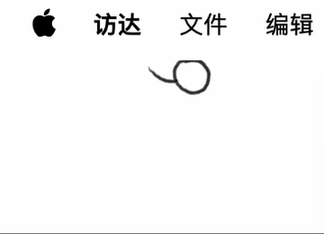
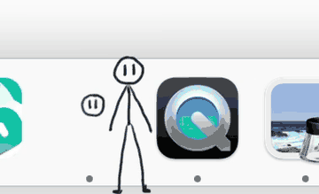
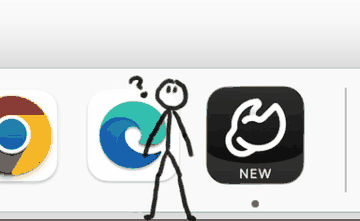
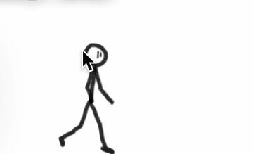
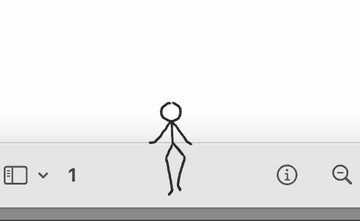
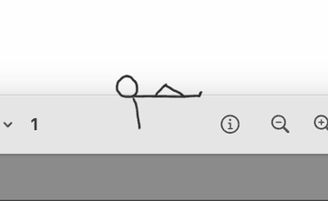
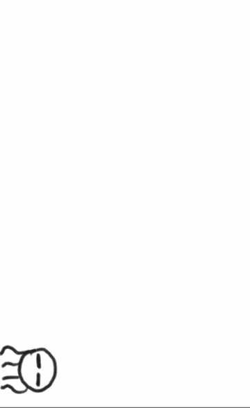
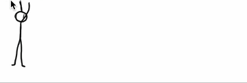
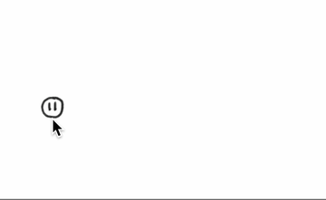

# MONO


> MONO — a monochrome stickman desktop pet that keeps you company. Not affiliated with the Mono/.NET project.
>
> 即：一只陪你待着的单色火柴人桌宠，与 Mono/.NET 项目无任何关联。

[English](README.md) · **简体中文**

**[下载 macOS 版](https://github.com/Hot-Peter/mono-desktop-pet/releases/latest)** — 解压后把 `MONO.app` 拖进「应用程序」即可。

**MONO**（取自 *monochrome*：用黑色墨水画成）是一只住在 macOS 桌面上的手绘火柴人。
大多数时候它挂在屏幕顶边、缩成一颗小球；双击它，小球会掉到桌面上散步、爬墙、爬天花板，
或者坐到某个窗口顶上打瞌睡——时不时冒个气泡，报告网速、电量，或者自己有多烫。

全部素材（97 帧手绘动画 + 气泡贴图 + 图标）都打包在仓库里，构建完即可离线运行，
不依赖任何外部资源，也不发起网络请求、不收集任何数据。

## 演示


### 它会做的小事

| 待机 | 打招呼 | 沉思 |
|:---:|:---:|:---:|
|  |  |  |
| **脸红** | **坐窗** | **躺平** |
|  |  |  |
| **爬墙** | **攀顶** | **拖拽** |
|  |  |  |

## 功能

- **待机**：小球挂在屏幕顶边左上角，原地转圈甩绳
- **双击小球**：掉到桌面开始走路
- **单击小球**：弹出菜单（语言、坐窗时置顶、打开智能体、回待机、退出等）
- **拖拽它**：
  - 靠近屏幕顶边松手 → 倒挂攀顶，沿顶边爬行
  - 靠近左 / 右边缘松手 → 贴墙爬
  - 靠近某个窗口标题栏松手 → 坐到窗口上打瞌睡（坐久了会躺平）
  - 把坐着的窗口关掉 → 它会变回小球掉到地上行走
  - 其他位置松手 → 落地继续散步
- **走路时**：偶尔停下来沉思、跟你打招呼；右键它 → 脸红一下
- **气泡**：实时网速（下行 / 上行）、电量（含充电状态）、系统热状态；
  气泡跟随头部移动、鼠标穿透，坐窗时会和小人一起被前面的窗口遮挡
- **中英双语**：气泡和菜单都支持中文 / English，默认跟随系统语言（中文/English），
  随时可以在小人的菜单里切换
- **单实例**：重复打开不会出现第二只小人
- **通用二进制**：Apple 芯片 / Intel 均可，macOS 12 或更高

## 构建与运行

只需要 Xcode 命令行工具（没有的话先执行 `xcode-select --install`）：

```bash
git clone https://github.com/Hot-Peter/mono-desktop-pet.git
cd mono-desktop-pet
./build.sh        # 生成 MONO.app
open MONO.app     # 运行
```

`./build.sh zip` 会顺便打出一个可分发的 `MONO-mac.zip`。

构建产物是 **adhoc 签名**（`codesign --sign -`），本机运行没问题；
要分享给别人，请看下面的安装说明。

## 从网上下载后第一次打开被拦？

本应用没有苹果开发者公证（个人手作软件），下载后第一次打开 macOS 会提示
“无法打开，因为 Apple 无法检查其是否包含恶意软件”，属正常现象，任选其一即可：

1. 右键 `MONO.app` → **打开** → 再点一次 **打开**；
2. 系统设置 → 隐私与安全性 → 找到“MONO 已被阻止” → **仍要打开**；
3. 终端执行 `xattr -dr com.apple.quarantine MONO.app`。

只有第一次会拦，之后双击就能正常启动。

> **想得到和作者完全相同的二进制？**
> Swift 工具链本身不保证逐字节可复现（同样的源码每次编译产物哈希都不同），
> 所以下载 [Releases](https://github.com/Hot-Peter/mono-desktop-pet/releases) 里的 `MONO-mac.zip` 才是与作者本机逐字节一致的版本；
> 从源码自行构建行为完全相同，仅二进制哈希不同。

## 安装到「应用程序」

`open MONO.app` 就能试用。想长期使用，把 `MONO.app` 拖进「应用程序」文件夹，
再在程序坞右键 → 选项 → 在程序坞中保留。

## 终端控制接口（调试用）

程序运行时会监听 `/tmp/stickman.sock`，可以用 `nc` 发指令：

```bash
echo "say 今天也要加油" | nc -U /tmp/stickman.sock   # 让它说一句话
echo "state" | nc -U /tmp/stickman.sock             # 查看当前状态
echo "lang en" | nc -U /tmp/stickman.sock           # 切换界面语言（system|zh|en）
echo "menu" | nc -U /tmp/stickman.sock              # 导出当前语言的菜单标题
```

## 目录结构

```
mono-desktop-pet/
├── Sources/            Swift 源码（5 个文件）
│   ├── main.swift          主程序：状态机、动画、坐窗、气泡跟随
│   ├── Bubble.swift        气泡窗口：手绘贴图、尾巴锚点、遮挡擦除
│   ├── SystemStats.swift   网速 / 电量 / 热状态（纯系统 API）
│   ├── L10n.swift          中英双语本地化
│   └── ControlServer.swift Unix socket 控制接口
├── Resources/          全部手绘素材（9 组动画 97 帧 + 3 张气泡 + 图标）
├── docs/               演示与动作 GIF
├── Info.plist          App 配置
├── build.sh            一键构建脚本
├── LICENSE             GPL-3.0（代码）
└── LICENSE-ART         CC BY-NC-SA 4.0（美术）
```

## 许可证

本项目采用双许可：

- **代码**（`Sources/`、`build.sh`、`Info.plist`）：[GPL-3.0](LICENSE) ——
  可自由运行、学习、分享、修改；分发修改版需继续沿用 GPL-3.0。
- **美术**（`Resources/` —— 97 帧手绘动画、气泡贴图、应用图标）：[CC BY-NC-SA 4.0](LICENSE-ART) ——
  仅供非商业使用；二次创作需署名，并以相同许可共享。

可构建、可跑、可fork 学习——但别拿这些画去卖钱。

## 说明

- 完全离线运行，不上传任何数据；只读取系统状态（网速、电量、热状态）用于填写气泡。
- 名字 **MONO** 取自 *monochrome*（单色）——整只小人用黑色墨水画成。本项目与
  Mono/.NET 项目及其维护者没有任何关联。
- 欢迎提 Issue 和 Pull Request。
